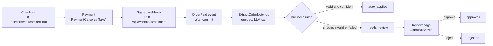

# OrderFlow


## Idea

OrderFlow is a small checkout and order service for a B2B wholesaler.

Customers order and pay online. A signed payment webhook confirms the payment, and it is safe against duplicate events. Customers often write special requests in the order note, like a delivery date or a PO number. An LLM turns these notes into structured data, and when it is not sure, a person reviews it on a small back-office page.

Built with Laravel 13, Livewire 4 and SQLite, with Claude Code as my AI agent.

## AI in the app

- **One narrow job.** After payment, Claude (`claude-haiku-5-5` by default, set with `ANTHROPIC_MODEL`) extracts three fields from the free-text order note: delivery date, PO number and invoice address. The answer is held to a fixed JSON schema (structured outputs), and the API is called with Laravel's Http client.
- **The note is data, not instructions.** All instructions are in the system prompt. The note is sent inside `<order_note>` tags it cannot close, the model has no tools, and it must flag `instructions_detected` when the note tries to instruct it. A flagged note always goes to review, whatever confidence it claims. An extraction only writes its own row, never the order's status, price or payment.
- **Nothing the model says is trusted blindly.** PHP validates every answer (types, lengths, a real date, confidence 0–1), and business rules decide the status: a past date, a date more than a year ahead, or confidence below 0.8 sends the extraction to `needs_review` with a `review_reason`. "Today" is the wholesaler's date in Europe/Berlin, not the server's UTC date.
- **Failures never lose an order.** Rate limits, server errors and timeouts are retried with backoff (3 attempts). Invalid answers, refusals and other API errors go to review at once, with the technical `error` and the `raw_response` kept. The job is idempotent: one row per order, enforced by a unique key.
- **Tests never call the real API.** Tests use `FakeOrderNoteExtractor` or `Http::fake`, and `Http::preventStrayRequests()` fails any unfaked call. Without an API key the app uses the fake, which sends every note to review.
- **A person decides the rest.** Extractions in `needs_review` are listed on `/admin/reviews`. The reviewer sees the original note, the reason and the confidence, can correct the three fields and approves or rejects. Approved fields are validated with the same lengths as the model's answer, and a past delivery date is blocked. A date more than a year ahead is allowed here: that rule exists because the model can misread a date, and a person who checked the note is the check. Only a date more than 2 years ahead is rejected, as a guard against typos.

## How I worked with the AI agent

I built OrderFlow with Claude Code as the agent that plans and writes the code. I used a
second Claude chat as a reviewer to challenge the plans. I made the final decisions.

**The loop for every step:**
1. I write a prompt with the goal, the rules and the tests I expect.
2. The agent reads `CLAUDE.md` and the earlier plans, and proposes a plan. No code yet.
3. The agent lists what it is unsure about. I answer each point and add what is missing.
4. The agent saves the plan with my decisions in `docs/plans/`, then implements it.
5. Pint, Larastan and all tests must pass. The agent lists what it changed and what it is
   still unsure about, and I decide again before pushing.
6. I write what happened in `AI_LOG.md`.

**Examples where I changed the agent's work:**
- **Stock levels in errors (Step 2).** The 409 for missing stock showed how much stock
  was left. I removed it, because a wholesaler does not want customers to see its stock.
- **Amount check (Step 3).** The plan marked an order paid without checking the amount.
  I added a check that the paid amount and currency match the order.
- **Prompt injection (Step 4).** I added an `instructions_detected` field. A note that
  tries to manipulate the model always goes to a person, because a manipulated model
  can't be trusted to judge itself.

**What I learned:**
- Asking the agent to list what it is unsure about found real problems early, like the
  untested race path and the timezone for "next Friday".
- A test is only useful if it can fail. The agent proved one by breaking the code on
  purpose and putting it back.
- With AI features, the hard part is not calling the model but deciding what happens
  when it is wrong.

**Files:**
- `CLAUDE.md`: the rules the agent follows.
- `docs/plans/`: each step's plan with my review decisions.
- `AI_LOG.md`: what I asked, what the agent proposed, and what I changed.

## Architecture



- **Thin controllers, Action classes.** Controllers validate input with a FormRequest, call one Action (for example `CheckoutCart`) and return an API Resource. Business rules live in `app/Actions`.
- **Checkout is all-or-nothing.** Locking products, re-checking stock, decrementing stock and creating the order happen in one DB transaction. Unique constraints on `cart_id` and `idempotency_key` make double checkouts and retried requests safe. A repeated `Idempotency-Key` returns the original order only if the request is the same; otherwise it is rejected with 409.
- **Orders are snapshots.** Order items copy the product name, SKU and unit price at checkout, so later catalog changes never change a past order. Money is always integer cents.
- **Explicit order lifecycle.** `OrderStatus` is an enum that owns its allowed transitions. An invalid transition throws a domain exception instead of quietly writing a bad state.
- **External services behind interfaces.** `PaymentGateway` is a contract bound in the service provider. Today it resolves to `FakePaymentGateway`, and tests never call a real provider.
- **Webhooks are verified before anything else.** Middleware checks an HMAC-SHA256 signature over `"{timestamp}.{raw body}"` with `hash_equals` and rejects timestamps more than 5 minutes in the past or future. An invalid request gets 401 before any database write.
- **Each event is processed once.** `webhook_events.event_id` is unique. A redelivered event fails the insert, `HandlePaymentWebhook` catches the unique violation and returns 200 `duplicate` with no second side effect, also when two deliveries race.
- **Out-of-order events are safe.** The order status only changes through `Order::transitionTo()`. An event that is not an allowed transition (for example `failed` after `paid`), an unknown payment reference or a wrong amount or currency is stored with its `outcome` for audit, but the status stays the same. A late `succeeded` after `failed` does mark the order paid, because the provider is the source of truth for money.
- **Side effects run after commit.** `OrderPaid` is dispatched only after the transaction commits, and a listener queues `ExtractOrderNote`. A rollback can never trigger note extraction for an order that is not paid.
- **Event row and status change are atomic.** If processing fails, both roll back, so the provider's retry is processed normally instead of being treated as a duplicate.
- **Back office behind built-in auth.** `/admin/reviews` is a Livewire page behind Laravel's session guard and a `review-order-notes` Gate that checks `users.is_admin`. No auth package: a page for one or two staff members does not need registration or password reset. Login is rate limited, and `is_admin` is not mass assignable.
- **Each review decision happens once.** Approve and reject go through `NoteExtractionStatus::transitionTo()` and one conditional update (`WHERE status = 'needs_review'`). A second click or a stale tab gets an error, and nothing is overwritten. The row records `reviewed_by_user_id` and `reviewed_at`.

## Run it locally

Requirements: PHP 8.3+, Composer, Node.js (for the front-end build in `composer setup`), and `curl` and `openssl` for the webhook example.

```bash
git clone https://github.com/krishnapriyaas/orderflow.git
cd orderflow
composer setup          # composer install, .env, app key, migrations, npm build
php artisan db:seed     # products, demo orders and the demo admin (local only)
```

Set a webhook secret in `.env` (any long random string), and an API key if you want real extractions:

```dotenv
PAYMENT_WEBHOOK_SECRET=change-me-to-a-long-random-string
ANTHROPIC_API_KEY=        # empty: the fake extractor is used and every note goes to review
```

Start the app and a queue worker in two terminals:

```bash
php artisan serve
php artisan queue:work
```

### Back office

Open <http://localhost:8000/login> and log in with the demo admin:

- Email: `admin@example.com`
- Password: `password`

The demo seeder only runs in the `local` and `testing` environments, so this account is never created on a real server. The page shows four demo notes to review, one for each kind of problem (low confidence, a prompt-injection attempt, a past date, an unavailable API).

### Place an order and send a signed webhook

The webhook is signed with HMAC-SHA256 over `"{timestamp}.{raw body}"`, sent as lowercase hex in `X-Signature`, with the Unix time in `X-Timestamp`. This script creates a cart, checks out with a note, and confirms the payment like the provider would (bash; JSON is read with `php -r`, so no `jq` is needed):

```bash
BASE=http://localhost:8000/api
SECRET=change-me-to-a-long-random-string   # the PAYMENT_WEBHOOK_SECRET from .env
json() { php -r '$v = json_decode(stream_get_contents(STDIN), true); foreach (explode(".", $argv[1]) as $k) { $v = $v[$k]; } echo $v;' "$1"; }

CART=$(curl -s -X POST "$BASE/carts" -H 'Accept: application/json' | json data.token)
curl -s -X POST "$BASE/carts/$CART/items" -H 'Accept: application/json' -H 'Content-Type: application/json' \
  -d '{"product_id": 1, "quantity": 2}' > /dev/null
ORDER=$(curl -s -X POST "$BASE/carts/$CART/checkout" -H 'Accept: application/json' -H 'Content-Type: application/json' \
  -H 'Idempotency-Key: readme-demo-1' -d '{"email": "buyer@example.com", "note": "Deliver next Friday, PO 4711"}')
REFERENCE=$(echo "$ORDER" | json data.payment.reference)
AMOUNT=$(echo "$ORDER" | json data.total_cents)

TIMESTAMP=$(date +%s)
BODY="{\"id\":\"evt_$TIMESTAMP\",\"type\":\"payment.succeeded\",\"data\":{\"payment_reference\":\"$REFERENCE\",\"amount_cents\":$AMOUNT,\"currency\":\"EUR\"}}"
SIGNATURE=$(printf '%s.%s' "$TIMESTAMP" "$BODY" | openssl dgst -sha256 -hmac "$SECRET" | sed 's/^.* //')

curl -s -X POST "$BASE/webhooks/payment" -H 'Accept: application/json' -H 'Content-Type: application/json' \
  -H "X-Timestamp: $TIMESTAMP" -H "X-Signature: $SIGNATURE" --data-raw "$BODY"
```

The answer is `{"outcome":"applied"}`. Sending the same request again returns `{"outcome":"duplicate"}`, and a wrong signature gets 401. The queue worker then extracts the note; without an API key it lands on the review page.

### Checks

```bash
vendor/bin/pint --test
vendor/bin/phpstan analyse
php artisan test
```

## Known limits

- **SQLite ignores row locks.** `lockForUpdate()` is a no-op on SQLite. SQLite serialises write transactions, so the tests are still valid, but they do not prove the locking under concurrent requests the way MySQL or PostgreSQL would.
- **No stock release yet.** When starting the payment fails, the order is marked `payment_failed` (HTTP 502), but its stock stays decremented. Releasing stock for failed or cancelled orders comes in a later step.
- **No payment retry flow.** Replaying a checkout with the same `Idempotency-Key` returns the existing order, even when it is `payment_failed`. There is no endpoint yet to start a new payment for a failed order.
- **Untested race path.** When two checkouts race, the losing request hits a unique constraint (`cart_id` or `idempotency_key`), and `CheckoutCart` catches it and returns the existing order or a 409. SQLite runs write transactions one at a time, so the test suite cannot produce this race and the path is not covered by tests.
- **Malformed signed webhooks get 422.** A correctly signed payload that is missing fields is rejected with 422 and an error log, and nothing is stored. The provider will keep retrying it until it gives up, so these errors need a person to look at them.
- **Amount mismatches need manual handling.** A webhook whose amount or currency does not match the order is stored as `amount_mismatch` and logged as an error, but nothing else happens. There is no alert or review flow for it yet.
- **No rate limit on the webhook.** A limit could block real provider retries after an outage, so there is none. Requests with a bad signature are cheap (rejected before any database query) and logged at info level only.
- **Stock release must handle late payments.** A late `payment.succeeded` moves a `payment_failed` order to `paid`. A future step that releases stock for failed orders must handle this, or an order could be paid after its stock went back on sale.
- **Extraction quality is not measured yet.** The tests prove the plumbing (request, validation, review rules), not how well the model reads real notes. Before production, run `claude-haiku-5-5` on a sample of real, anonymised order notes and check the results and the 0.8 threshold by hand; switch `ANTHROPIC_MODEL` to a larger model if Haiku falls short.
- **Order notes are personal data.** Notes can contain names and addresses, and they are sent to Anthropic for extraction. A real deployment needs this in the privacy notice and a data processing agreement (GDPR), and should check the provider's data retention settings. To keep stored data to a minimum, `raw_response` holds only the model's answer text (the extracted fields), not the full API response; API error bodies are not stored at all.
- **Prompt injection is limited, not impossible.** A note can still try to mislead the model. The model's `instructions_detected` flag and its confidence are self-reported, so a clever note could get past both. What it can reach is only the three extracted fields on its own row, which a customer could have typed into the note anyway.
- **Concurrent duplicate jobs.** If the same job ran twice at the same moment, both runs would call the LLM; the unique key keeps only one row. Jobs are queued once per paid order, so there is no `WithoutOverlapping` lock for now.
- **Fixed retry backoff.** HTTP 429 is retried after 30 s and 120 s; the API's `retry-after` header is not read.
- **Real LLM API not yet called.** All tests use fakes or Http::fake. The request format still needs one check with a real API key.
- **One admin role.** `is_admin` is a single flag. There are no roles or per-user permissions, and no way to manage admins in the app.
- **Demo credentials.** The demo admin uses `password`. It is only seeded in `local` and `testing`, but any real deployment needs its own admin account and a strong password.
- **No alert for the review queue.** Nobody is notified when a note goes to review; someone has to open the page.
- **Approved data stays on the extraction row.** Approved or auto-applied fields are not sent anywhere yet (ERP, delivery planning, invoicing). Rejected rows keep the model's fields for audit, and the order then has no structured data.
- **No browser test for the review page.** The page is tested with Livewire's test helpers and HTTP tests, not with a real browser (Dusk).

## What I would do next

- Call the real API once with a real key to check the request format, then run the model on a sample of real, anonymised notes and tune the 0.8 threshold.
- Release stock for failed and cancelled orders, with the late-payment case handled.
- An endpoint to start a new payment for a `payment_failed` order.
- An alert (mail or Slack) for amount mismatches, malformed webhooks and a growing review queue.
- Push approved and auto-applied fields to the wholesaler's ERP or invoicing system.
- Read the API's `retry-after` header instead of a fixed backoff.
- Run the tests on MySQL or PostgreSQL in CI, so the row locks and the checkout race are really tested.
- A browser test for the review page.
